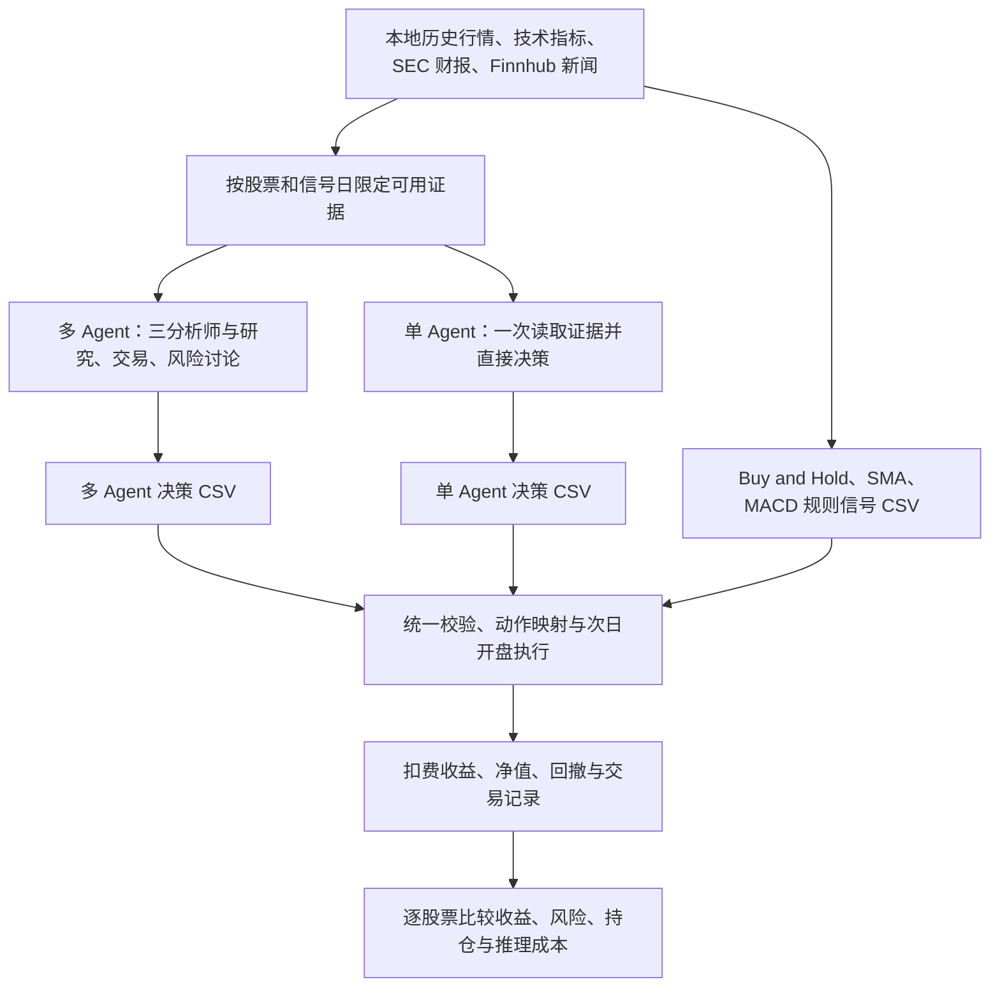
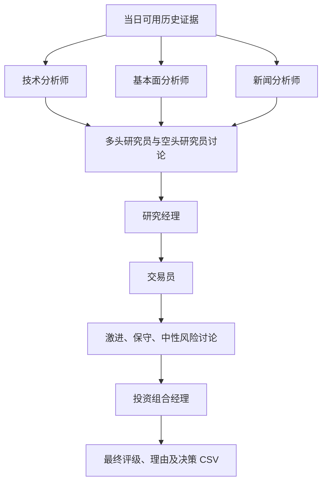
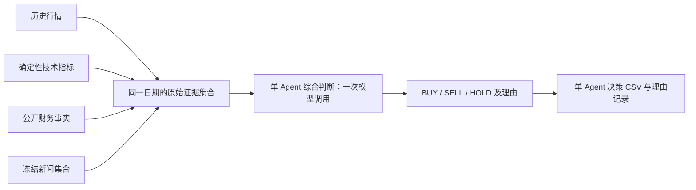

# TradingAgents：单 Agent 与多 Agent 交易决策对比

本项目研究：在相同历史行情、技术指标、财报和新闻证据下，单个大语言模型直接决策，与分角色、多阶段讨论的多 Agent 工作流，在交易收益、风险及推理成本上有何差异。

多 Agent 使用技术、基本面、新闻三类分析师，共 11 个决策角色；单 Agent 则一次性读取相同的原始证据，直接输出交易动作及理由。两种方法均先保存决策 CSV，再通过同一套回测逻辑评价。Buy and Hold、SMA、MACD 提供规则基线。

## 1. 整体流程



单Agent入口为`agents/single_agent.py`，通过同一实验调度器选择`--mode single_agent`运行；不以多Agent的分析师开关替代单Agent。

## 2. 数据与信息时间

评价股票固定为 AAPL、GOOGL、AMZN，分别回测，不将其合成为一个投资组合。行情历史用于计算指标和预热；评价日期由决策 CSV 推导。

| 数据 | 来源与内容 | 时间规则 |
|---|---|---|
| 行情 | 本地 Yahoo OHLCV、拆股和分红 | 截至信号日 D 的实际收盘 |
| 技术指标 | 从可见历史行情计算均线、MACD、RSI、布林带等 | 仅使用 D 及以前行情 |
| 财报 | 本地 SEC 财务事实，包含公开接受时间 `accepted_at` | 既有实验按 D 纽约时间 23:59:59 解释 |
| 新闻 | Finnhub Company News 标题、摘要、来源、时间与 URL | 纽约时间 D−7 日 00:00（含）至 D 日 00:00（不含） |

新闻按精确发布时间过滤、去重后取最多 20 条最新记录。窗口使用日历日，包含周末。例如 D=2026-07-01，新闻窗口为 06-24—06-30；种子日 06-30 的新闻预热最早覆盖 06-23。新闻是供应商标题和摘要，不是全文或完整事件集合。

行情和财报通过 `agents/local_data_vendor.py` 接入框架，避免历史实验自动回退到当前在线财务视图。新闻在模型调用前预取，冻结路径和 SHA256；新闻分析师读取该快照。请求失败与成功的空新闻窗口分别记录，不能把抓取失败解释为没有新闻。未提供的内幕交易数据明确标记不可用，不由模型补造。

### 同信息对照原则

对同一股票和日期，单 Agent 与多 Agent 应使用相同的数据版本、时间截止、行情长度、指标数值、财报选择和新闻集合。单 Agent 读取原始证据或确定性计算结果，不读取任何多 Agent 生成的分析、辩论、交易建议或最终结论。多 Agent 的分析师按职责读取对应证据，单 Agent 读取这些原始证据的合并集合。

当前多 Agent 的技术和财报工具存在按需查询，不能仅凭“都来自同一个数据目录”就认定输入完全相同；对照应固定共同证据范围，并保存输入内容及来源。相同证据不等于相同提示词、调用次数或推理预算。

### 历史时间标签与执行边界

交易在下一交易日开盘执行，因此 D 当晚已公开的财报属于成交前可用信息；这不表示覆盖了次日盘前或周末新增的全部消息。既有决策 CSV/日志中的收盘信息截止与收盘后半小时决策时间属于旧标签，不能准确代表当时盘后财报的实际输入范围，原始记录保持不变。

代码接入边界：当前新运行的 vendor、运行器和信号校验仍采用实际收盘截止。按上述盘后口径生成新的单／多 Agent 对照时，须同时统一这三处时间处理，不能只修改声明或 CSV 标签。历史输入解释与当前代码默认值在这里分别说明。

## 3. 多 Agent 方法：三分析师、11 个角色

基础模型使用 DeepSeek Flash，报告语言为英文。角色分工如下：

| 阶段 | 角色 | 职责 |
|---|---|---|
| 分析 | 技术分析师 | 分析历史价格、量能、趋势和技术指标，形成技术报告 |
| 分析 | 基本面分析师 | 分析当时已公开的财务事实，形成基本面报告 |
| 分析 | 新闻分析师 | 分析历史新闻事件、经营影响及证据不确定性 |
| 研究 | 多头研究员 | 基于三份报告提出买入论据并回应空头观点 |
| 研究 | 空头研究员 | 提出下行风险和反对买入的论据，回应多头观点 |
| 研究 | 研究经理 | 综合多空讨论，形成研究建议 |
| 交易 | 交易员 | 将研究建议转化为交易计划 |
| 风险 | 激进风险角色 | 从承担风险、争取收益的角度审视计划 |
| 风险 | 保守风险角色 | 从控制损失和证据不足的角度审视计划 |
| 风险 | 中性风险角色 | 权衡收益机会与风险，参与风险讨论 |
| 决策 | 投资组合经理 | 综合交易计划和风险讨论，给出最终评级及理由 |



三类分析师分别产出报告，报告汇齐后进入多空讨论；研究和风险讨论各配置一轮。只有最终投资组合经理的输出进入回测，不将分析师观点或中间交易计划当作独立买卖信号。

经理评级映射为：Buy / Overweight → BUY，Hold → HOLD，Underweight / Sell → SELL。原始评级和理由保存在完整状态及报告中。11 指决策角色数量，不等于固定 11 次模型调用；工具查询、重试及反思可能增加调用。

框架还包含Memory Log与反思机制，既有多Agent运行启用了该机制；它不计入上述11个决策角色。2026-11-09由周晓杨确认：单/多Agent主比较保留长期记忆、使用完整期间，不排除7月30日—8月3日。输入对齐协议见[单Agent实验配置](experiments/single_agent_protocol.json)。

为对齐记忆输入，单Agent读取参考实验归档中的同一组历史经验，沿用`TradingMemoryLog.get_past_context`规则：最多同股票5条、跨股票3条，只允许`resolved`日期不晚于当前信号日的已结算记录，排除pending及未知结算日期。参考记忆只读，单Agent输出独立保存；不读取当前日期或之后的多Agent决策。初期尚无已结算经验时上下文为空，仍属于启用记忆的正常情况。

此项定义是“共享历史记忆条件下的工作流对照”，不是两个系统分别从自身交易生成不同经验。归档可用于重建当日合格记忆，但原实验未逐次保存实际注入的记忆文本，历史提示词逐字一致尚未证明。行情/财报工具按需查询及盘后财报截止差异仍须核对，不能仅因记忆规则相同就宣称全部输入已严格对齐。若需要补做成对验证，两种方法应记录各自实际收到的证据和记忆哈希。

## 4. 单 Agent 方法：一次读取证据、直接决策

单 Agent 使用与多 Agent 相同的基础模型，一次性接收该股票、该日期的四部分证据：历史行情、技术指标、可用财报及历史新闻。由这个 Agent 自行综合趋势、基本面、事件与风险，直接输出一个动作及理由。



单 Agent 不经过多空辩论、研究经理、交易员、风险讨论或投资组合经理，不读取多 Agent 报告，也不在模型调用后额外调用其他 Agent 修改动作。数据准备由程序完成，不计作模型分析角色。每个股票—日期以一次成功请求为目标，失败和重试另行记录。

当前实现使用同一DeepSeek Flash客户端、归档新闻以及按日期过滤的长期记忆。行情/财报先校验原始文件SHA256与参考截面行数，再复用本地vendor计算确定性的工具证据。旧工具调用全文未归档，因此输入是固定工具集合的重建，不等同于旧提示词逐字回放；派生行情序列的序列化哈希也可能受原Windows环境/数值计算影响，这些核对结果逐次写入alignment字段，不隐藏为“完全一致”。新闻缺失、哈希变化和原始数据变化均停止该cell，不在线刷新或补造。

默认`end_of_day`财报口径匹配既有实验的盘后解释，并将新CSV时间如实写为当日23:59:59截止、其后1微秒决策；显式`market_close`模式可用于新的收盘截止条件。两种口径使用不同策略版本，不混合输出。原多Agent的旧时间标签保留；此兼容设置没有消除历史输入记录不完整的限制。

每个cell保存`evidence.json`、`response.json`、`decision.json`及runs.jsonl。成功响应先落盘，CSV适配或写入失败后可离线恢复，恢复的新增调用/token为0；无效JSON保留失败，不自动HOLD，不追加一次修正模型调用。不同策略使用独立路径，单Agent命令与批量入口共用进程锁。SDK内部HTTP重试由框架管理，逻辑LLM调用数不代表逐次HTTP尝试数。

动作要求与多 Agent 一致：BUY 表示目标全仓做多，SELL 表示目标空仓，HOLD 表示延续已有仓位。理由应说明主要依据、风险与不确定性；动作和理由分开保存，回测只使用动作。无效或缺失输出应记录失败，不自动替换为 HOLD。

## 5. 决策 CSV 与统一回测

### 信号接口

每个策略分别保存 CSV，核心六列为：

```text
ticker,decision_time,information_cutoff,action,strategy_version,source
```

`strategy_version`区分实验条件和版本；`source`区分最终经理、单Agent与规则基线。多Agent来源为`portfolio_manager`；单Agent使用`single_agent`，理由保存在运行记录。Notebook已显式指定单Agent来源及盘后截止策略，调度器续跑按来源识别。

每股每日一条最终动作，包含评价前一个交易日的种子信号及评价末日。重复、缺失、非法动作和不符合时间约定的记录应报错，不用 HOLD 补齐。

### 日期、仓位与成交

| 参数 | 评价约定 |
|---|---|
| 种子信号日 | 2026-06-30 |
| 评价期间 | 2026-07-01—2026-10-09 |
| 决策行数 | 每股 72 行，包含种子日及末日 |
| 收益区间 | 完整期间每股 70 个开盘至下一开盘区间 |
| 初始状态 | 净值 1、仓位 0，各策略独立评价 |
| BUY / SELL / HOLD | 目标仓位 1 / 0 / 延续前值；初始 HOLD 为空仓 |
| 成交 | D 的信号在下一交易日开盘执行 |
| 期末 | 未知未来收益不补零，不额外强制平仓 |

评价期间共 71 个交易日，只有 70 个终点仍在区间内的开盘到开盘收益。末日决策用于信号覆盖校验，不计其在评价区间之后的持有收益。历史行情保留用于指标预热，不因此扩大 Agent 评价区间。`config.json` 中的旧 train/test 日期供旧工具使用，不决定 Notebook 的当前评价窗口；本窗口作为整体历史评价，不称为未查看的盲测留出集。

### 收益、成本、净值与回撤

各策略在 `analysis.ipynb` 中共用 `prepare_backtest`、`cal_net_values` 和 `run_backtest`。动作先映射为目标仓位，再对齐下一可成交开盘，资产收益只计算一次。

```python
asset_ret = (next_open + next_dividend) * next_split / open - 1
turnover = abs(position - previous_position)
cost = turnover * 0.001
strategy_ret = position * asset_ret - cost
net_values = 1 + strategy_ret.cumsum()
drawdown = net_values / running_peak - 1
```

手续费 5 bps、滑点 5 bps，合计每单位换手 10 bps。首次建仓计费，持仓不变不收费；资产收益按当前实现计入拆股和分红。默认 `RETURN_TYPE="simple"`、`NAV_MODE="additive"`，净值按固定初始基数加法累计；运行峰值包含初始净值 1。可用 `NAV_MODE="compound"` 切换复利，但对照策略必须采用同一口径，不混用加法累计与复利账户收益。

### 规则基线

- Buy and Hold：种子日 BUY，此后 HOLD。
- SMA：20 / 50 日均线差为正时 BUY，为负时 SELL，为零时 HOLD。
- MACD：12 / 26 / 9 参数，MACD 与信号线之差为正时 BUY，为负时 SELL，为零时 HOLD。

SMA 与 MACD 基线在含公司行动的总收益指数上计算指标；基线和两类 Agent 的交易日期、仓位映射、费用及评价函数保持一致。

### 特殊日期筛选与图表

Notebook 开头的 `EXCLUDE_PERIODS` 控制事后观察窗口，例如：

```python
EXCLUDE_PERIODS = []  # 主比较使用完整期间，保留7/30—8/3
# EXCLUDE_PERIODS = [("2026-07-30", "2026-08-03")]  # 仅用于另存的敏感性分析
```

先计算完整仓位、收益与费用，再排除与指定日期范围相交的收益区间，重算净值和回撤；所有股票及策略使用相同筛选。不会删除行情后拼接价格，也不会跨筛选缺口重新计算换手。被剔除期的收益和费用一起剔除，保留期费用不变。这属于事后敏感性分析，不能解释为策略事先知道应避开事件。

完整输出位于 `results/agent_period/`，筛选输出位于 `results/agent_period_filtered/`；输出中的 `run.json` 记录实际参数。图表按股票展示净值与独立回撤面板，回撤使用细实线及同色浅填充。切换参数不会自动删除另一版本的历史输出。

## 6. 比较与结果解释

逐股票并列比较单 Agent、多 Agent 及规则基线：累计净收益、最大回撤、年化 Sharpe、年化波动率、换手次数和费用。Sharpe 使用 252 日年化、无风险利率 0、总体标准差；收益按区间终点归属日期。另比较持仓比例、平均持仓时长和事件窗口附近仓位，以检验“更谨慎地参与行情”的行为解释。

推理成本分别记录模型调用、输入／输出 token、耗时、失败／重试和实际 API 费用；交易成本与推理成本分开报告。多 Agent 与单 Agent 的调用预算不同，因此结果解释为两种工作流的收益—风险—成本比较，不能仅凭收益差将效果完全归因于协作机制。

对上涨、震荡或下跌的判断应有价格或预先定义的行情指标支持。空仓可以证明低持仓暴露；只有决策理由明确提及财报风险时，才将其归因为主动规避财报不确定性。避免把事后排除窗口的收益路径当作原始股价，或由三只股票的一个短窗口推断普遍有效性。历史数据修订、模型预训练记忆和已查看的行情也是研究限制。

## 7. 项目结构

```text
README.md          项目方法、流程、回测与运行说明
analysis.ipynb     分步中文回测、指标与图表
config.json        费用、指标及旧工具日期参数
data.py            行情、财报、交易日历与历史过滤
signals.py         决策读取、经理评级映射及信号校验
settings.py        配置及可选实验冻结工具
requirements.txt   统一依赖入口，安装本地 framework
agents/            Agent 运行、本地数据接入与恢复工具
  logs/            请求日志、新闻缓存、报告、完整状态和记忆
experiments/       实验清单、串行调度、token 台账与修复证据
data/              prices、financials、raw、decisions 与 sources.json
results/           逐期收益、交易记录、指标、图表及运行参数
framework/         修改后的 TradingAgents 框架、CLI、测试与许可证
tests/             课程代码的关键计算和接入测试
docs/              原研究计划、提交材料、团队及历史核查记录
```

根目录 README 是唯一项目说明。`docs/` 保留历史材料及研究证据，其中早期四分析师、旧日期、开发／留出划分等内容不作为本项目当前方法定义；研究范围以本文的三分析师、11 角色与同信息单 Agent 对照为准。

## 8. 环境与运行

在项目根目录使用 Python 3.11：

```bash
conda activate py311_env
python -m pip install -r requirements.txt
```

安装入口以 editable 方式安装 `framework/`，无需再克隆上游仓库。打开 `analysis.ipynb`，选择上述环境并从头执行。默认多 Agent 信号路径为：

```text
data/decisions/ta-v0.6.0-deepseek-flash-market-news-fundamentals-main-2026jul-oct-v1.csv
```

读取已有CSV回测无需API Key，不调用模型。Notebook保留AGENT_CSV多Agent输入，并新增SINGLE_AGENT_CSV；单Agent文件存在时必须覆盖全部三股216个信号位置，再加入相同函数计算，缺失不补HOLD。完整对比输出到`results/single_vs_multi/`，不覆盖既有`results/agent_period/`。主比较默认`EXCLUDE_PERIODS=[]`，不排除7/30—8/3。

### 单Agent运行

先安装根目录requirements.txt。以下命令只读取归档，不请求新闻API或模型，不需要Finnhub Key：

```bash
python -m agents.single_agent --ticker AAPL --date 2026-08-03 --dry-run
python -m experiments.run_experiments --mode single_agent \
  --manifest experiments/manifests/single_2026jul_oct_v1.csv --dry-run --limit 3
```

以下命令会调用付费DeepSeek API；先填写本地DEEPSEEK_API_KEY并核对预算。单次入口默认dry-run，必须显式给出`--execute`才调用模型；批量入口沿用原调度器约定，未加`--dry-run`即真实运行：

```bash
python -m agents.single_agent --ticker AAPL --date 2026-06-30 --execute
python -m experiments.run_experiments --mode single_agent \
  --manifest experiments/manifests/single_2026jul_oct_v1.csv --limit 3
# 完成小规模核验后去掉 --limit 3；相同命令续跑跳过已完成cell。
```

默认信号文件为`data/decisions/deepseek-flash-single-shared-memory-2026jul-oct-v1.csv`。未完成全覆盖前，Notebook会拒绝这份部分CSV；验证时可先使用单次命令的`--output`另存pilot文件。证据或配置变更须使用新策略版本。新机器需要完整的参考日志目录`agents/logs/e/f6e0d4240635/`；其余路径与读取规则见实验协议JSON。

生成新多 Agent 信号前，复制 `.env.example` 为 `.env`，填写 `DEEPSEEK_API_KEY` 和 `FINNHUB_API_KEY`；保持 `TRADINGAGENTS_ANALYSTS=market,news,fundamentals`、`TRADINGAGENTS_NEWS_VENDOR=finnhub`。密钥及 `.sec_user_agent` 不提交 Git。

```bash
python -m agents.check_env
python -m agents.run_agents --ticker AAPL --date 2026-07-01 --dry-run
python -m experiments.run_experiments --dry-run --limit 3
```

`check_env` 检查环境与配置；dry-run 校验本地数据与日期，不验证在线新闻权限或模型输出。以下命令会请求新闻并调用付费模型；新实验须先满足前文的信息截止及对照约定：

```bash
python -m agents.run_agents --ticker AAPL --date 2026-07-01 \
  --analysts market,news,fundamentals --strategy-version example-v1 \
  --output data/decisions/example-v1.csv

python -m experiments.run_experiments \
  --manifest experiments/manifests/main_2026jul_oct_v1.csv --round 1 --rounds 6
```

调度器按清单串行执行、跳过已完成的决策；同一次实验续跑使用相同策略版本。不同策略采用独立版本、决策文件、日志及 checkpoint，避免多个进程同时写同一文件。`--round` 使用完整清单的累计前缀。

Finnhub 缓存保存在对应实验日志目录下的 `cache/finnhub/`，记录查询窗口、原始返回、抓取时间与哈希；相同查询复用缓存。认证失败或请求错误停止该 cell，不生成猜测决策；已成功返回的空列表可以继续，并明确证据不足。请求按当前进程限速并重试，批量运行保持串行。保留缓存供对照复用，不在实验中途刷新证据。

离线测试：

```bash
python -m pytest -q
python -m pytest -q framework/tests/test_finnhub_news.py framework/tests/test_report_html.py
```

历史市场诊断材料位于 `docs/market-period-comparison/`，可运行 `python docs/market-period-comparison/analyze.py`。该脚本读取本地数据，以收盘总收益诊断两个候选时期，边界与本项目开盘成交回测不同，不将其指标混作策略结果。

## 9. 来源与许可

本地框架基于 [TauricResearch/TradingAgents](https://github.com/TauricResearch/TradingAgents) v0.6.0，保留原始 [Apache-2.0 许可证](framework/LICENSE)。行情、财报的原始来源记录在 `data/sources.json`，新闻来源与窗口随实验日志保存。研究计划与团队记录保存在 `docs/`，原始实验决策、日志、修复备份和历史提交材料保留用于追溯。
