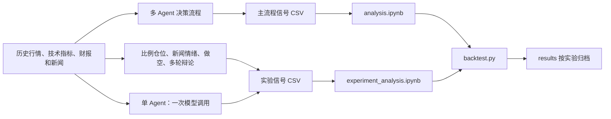

# TradingAgents 交易实验与回测

项目用 AAPL、GOOGL、AMZN 的历史行情、SEC 财务事实和 Finnhub 公司新闻研究日频交易策略。仓库包含一套多 Agent 决策流程和五项实验：比例仓位、新闻情绪、做空、多轮辩论和单 Agent。信号先保存为 CSV，再按下一交易日开盘成交的假设回测。



## 运行回测

在项目根目录运行以下命令安装依赖，并选择同一个 Python 3.11 环境作为 Notebook 内核。安装入口会以 editable 方式安装本地框架。

```bash
conda activate py311_env
python -m pip install -r requirements.txt
```

| 入口 | 使用的信号 | 输出目录 |
|---|---|---|
| [analysis.ipynb](analysis.ipynb) | `AGENT_CSV` 指定的多 Agent 信号及 Buy and Hold、SMA、MACD 规则信号 | `results/original/` |
| [experiment_analysis.ipynb](experiment_analysis.ipynb) | `VARIANT_CSVS` 中的实验信号，按各实验的信号日期回测 | `results/position/`、`results/sentiment/`、`results/short/`、`results/debate/`、`results/single/` |

两本 Notebook 都可独立从头运行，读已有信号无需 API Key。它们共用 [backtest.py](backtest.py) 中的信号对齐、收益、费用、指标、绘图和导出函数。

两本 Notebook 开头的 `EXCLUDE_PERIODS` 控制日期筛选。设为 `[]` 时输出到各实验的 `full/`，填写日期窗口时输出到 `filtered/`。每个目录包含指标、月收益、逐期明细、换手记录、净值及回撤图。实际输入路径和运行参数记录在 `run.json`，信号 CSV 集中保存在 `data/decisions/`。

## Agent 决策与信号

多 Agent 主流程中，技术、基本面、新闻分析师分别产出报告。多头与空头研究员依据报告辩论，研究经理形成建议，交易员制定方案。激进、中性、保守三位风险分析师审查后，由投资组合经理作出最终决策。记忆节点会提供当时可用的历史经验，它单独计入调用成本。

多 Agent 主流程的 [历史信号 CSV](data/decisions/ta-v0.6.0-deepseek-flash-market-news-fundamentals-main-2026jul-oct-v1.csv) 为每只股票每日一条 BUY／SELL／HOLD，由最终经理评级映射。BUY 为 1，SELL 为 0，HOLD 延续前值。回测从种子日 2026-06-30 的信号开始，评价区间为 2026-07-01 至 10-09，每股有 70 段开盘至下一开盘收益。

## 五项实验

[experiment_analysis.ipynb](experiment_analysis.ipynb) 从 `data/decisions/` 读取下表中的信号。比例仓位、新闻情绪、做空和多轮辩论已有归档信号。单 Agent 的 CSV 由外部运行生成，文件到位后自动纳入回测。

| 实验 | 决策方式 | 信号路径（相对于 `data/decisions/`） |
|---|---|---|
| 比例仓位 | 根据前一目标仓位调整持仓比例 | `position/position_aug.csv` |
| 新闻情绪 | 从历史新闻快照提取情绪证据 | `sentiment/sentiment_aug.csv` |
| 做空 | 允许经理批准做空，另有历史评级映射版本 | `short/short_approval_aug.csv`、`short/short_mapping.csv` |
| 多轮辩论 | 设置一轮或三轮多空辩论 | `debate/debate_r1_sep.csv`、`debate/debate_r3_sep.csv` |
| 单 Agent | 每股每天调用模型一次，读取行情、技术指标、可用财报和历史新闻，直接给出 0 或 1 | `single/single_agent.csv`（待导入） |

五项实验使用同一 CSV 格式。

```text
ticker,signal_date,target_weight
```

`signal_date` 是纽约市场的决策交易日。每股从第一个成交日前一交易日的种子信号开始，按交易日给出目标仓位。下一开盘按该仓位执行，−1 为满仓做空，0 为空仓，1 为满仓做多，小数代表部分仓位。维持仓位时重复前一日的值。单 Agent 只接受明确填入的 0 或 1，其余实验的空权重填 0。回测检查交易日覆盖，并将一般数值权重截断至 [−1, 1]。

如需选择其他归档信号，在 Notebook 的 `VARIANT_CSVS` 中填写相对路径和图例。路径首层目录为实验名，输出写入对应的 `results/<实验>/`。各实验的 `exploratory/` 存放早期探索信号，其中部分日期覆盖不全。

历史做空评级映射使用既有评级生成目标仓位。历史保持股数指令在导入时转换为延续前一目标权重。

## 回测口径

对每只股票独立回测，从仓位 0、净值 1 开始。本期收益区间从成交开盘至下一开盘，资产收益计入分红与拆股。评价末日之后的未知收益不补零，且期末无额外强制平仓。

```python
asset_ret = (next_open + next_dividend) * next_split / open - 1
turnover = abs(position - previous_position)
cost = turnover * 0.001
strategy_ret = position * asset_ret - cost
net_values = 1 + strategy_ret.cumsum()
drawdown = net_values / running_peak - 1
```

手续费 5 bps、滑点 5 bps，初始建仓计费。相邻目标相同则换手为 0。当前费用模型包含换手成本，做空的借券费未计入。默认用简单收益和加法净值，`NAV_MODE="compound"` 可切换到复利。最大回撤的运行峰值包含初始净值 1，Sharpe 按 252 日、无风险利率 0 年化。

所有策略先在完整仓位上计算收益和费用，再按同一筛选条件移除相交的区间并重算净值。筛选后保留各期原有费用，用于观察指定窗口对结果的影响。

## 信息时间与新信号生成

行情和技术指标使用信号日及以前的数据。历史 Finnhub 新闻窗口为纽约时间信号日前 7 个日历日至前一日，去重后最多 20 条。新闻快照随运行记录保存。已归档主实验的财报可用范围按信号日纽约时间 23:59:59 解释。当前新生成决策按交易日实际收盘时间过滤 SEC 财务事实。单 Agent 的生成流程使用当日收盘前已可用的信息。

将 `.env.example` 复制为 `.env` 并设置 DeepSeek 和 Finnhub Key 后，可运行多 Agent 主流程。先做离线检查：

```bash
python -m agents.check_env
python -m agents.run_agents --ticker AAPL --date 2026-07-01 --dry-run
python -m experiments.run_experiments --dry-run --limit 3
```

多 Agent 主流程可按日期区间使用 `agents.batch_run`，或用 `experiments.run_experiments --manifest <path>` 按清单运行。真实运行会请求新闻并调用模型。比例仓位、新闻情绪、做空和多轮辩论使用以下入口，每次运行一个股票和信号日。默认离线检查，实际生成信号时加 `--live`。

```bash
python -m agents.run_variant --variant position --ticker AAPL --date 2026-07-31
```

`--variant` 可选 `baseline`、`position`、`sentiment`、`short`、`debate`。比例仓位读取前一个目标值，新闻情绪从同一份历史新闻快照提取证据，做空由最终经理选择 −1、0 或 1，多轮辩论可用 `--rounds` 配置。按交易日依次运行，默认信号写入 `data/decisions/<实验>/numeric-*.csv`。

```bash
python -m pytest -q
python -m pytest -q framework/tests/test_finnhub_news.py framework/tests/test_report_html.py
```

## 目录与来源

```text
analysis.ipynb            多 Agent 主流程回测
experiment_analysis.ipynb 五项实验的回测
backtest.py               两本 Notebook 共用的公式、指标和导出
data.py / signals.py      读取与校验数据、决策
config.json / settings.py 回测参数及可选实验冻结
agents/                  多 Agent 运行入口、实验运行入口和日志
agents_position/         比例仓位
agents_sentiment/        历史新闻情绪
agents_short/            做空
agents_debate/           多轮辩论
agents_single/           单 Agent 外部 0／1 仓位信号校验
experiments/              历史运行清单、调度、费用和修复记录
data/                     本地行情、财报及信号
results/                  按实验和筛选方式归档的回测结果
framework/                本地 TradingAgents 框架及许可证
tests/                    课程项目的离线检查
```

框架基于 [TauricResearch/TradingAgents](https://github.com/TauricResearch/TradingAgents) v0.6.0，采用 [Apache-2.0 许可证](framework/LICENSE)。行情及财报来源记录在 [data/sources.json](data/sources.json)。归档变体信号来自组员交接分支 [fc54379](https://github.com/CatchMan1/TradingAgent-project/tree/fc54379/handoff)。

项目贡献：周晓杨负责统筹与整合，Zhou Runyu 负责 Agent 工程接入，Li Ziqi 负责工程架构、数据和回测，Zhao Tianyu 负责实验运行及成本记录。
