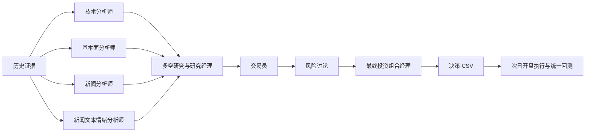

# TradingAgents：多 Agent 协作交易研究

研究目标：在相同历史证据、模型和交易规则下，比较四分析师多 Agent 工作流与同信息单 Agent 的收益、风险和推理成本，再通过消融与一个小幅优化分析协作的作用。

**第一版回测已跑通。最终研究架构采用四分析师；目前已生成并用于回测的信号来自三分析师版本，四分析师、单 Agent、消融和优化结果尚未完成。** 本文的回测日期、费用和净值口径以当前 `analysis.ipynb` 为准。

## 研究方案

四类分析师分别负责：

- 技术分析：历史行情与技术指标。
- 基本面分析：已公开的 SEC 财务事实。
- 新闻分析：历史公司新闻中的事件与经营影响。
- 新闻文本情绪分析：同一批历史新闻的语气、分歧与倾向，不将其称为历史社交媒体情绪。



最终比较包括：四分析师多 Agent、读取同一原始证据的单 Agent、无多空辩论消融，以及在开发段选定的一个优化版本。各条件使用相同股票、日期、证据、成交规则与费用。Buy and Hold、SMA、MACD 为免费规则基线。单独启用一个分析师仍包含后续讨论链，不能充当同信息单 Agent 对照。

正式对照计划隔离跨日期学习记忆，并明确开发与留出边界；当前已运行版本仍包含记忆/反思，且整个信号期间已经查看过结果，不能将其描述为未查看的独立留出测试。API 总预算目标为 80 美元，历史失败和重试也应计入；当前 token 台账已保存，实际美元成本待补。

## 当前版本与回测口径

| 项目 | 当前实现 |
|---|---|
| 股票 | AAPL、GOOGL、AMZN，分别回测 |
| 已有 Agent | 技术、新闻、基本面三分析师；DeepSeek Flash；研究和风险讨论各一轮 |
| 决策数量 | 216 条，三股各 72 条，包含种子日和末日 |
| 种子日期 | 2026-06-30 |
| 回测日期 | 2026-07-01—2026-10-09，由决策 CSV 推导 |
| 收益观测 | 每股 70 个区间内开盘至下一开盘收益；末日之后的未知收益不计 |
| 动作与仓位 | BUY=1、SELL=0、HOLD 延续仓位，初始空仓；不做空 |
| 成交 | 信号在下一交易日开盘执行，持有至下一开盘 |
| 换手成本 | 手续费 5 bps + 滑点 5 bps，共 10 bps × 仓位变化绝对值；初次建仓扣费 |
| 收益 | 简单收益，计入拆股及分红；不额外强制期末平仓 |
| 默认净值 | 加法净值 `1 + cumsum(strategy_ret)`，起点为 1 |
| 风险指标 | 基于同一净值计算回撤；Sharpe 使用 252 日年化、无风险利率 0、总体标准差 |
| 同期基线 | Buy and Hold、SMA、MACD，与 Agent 共用回测函数 |

每期策略收益为 `position * asset_return - abs(position_change) * 0.001`。Notebook 可通过 `NAV_MODE="compound"` 切换复利，但当前默认输出为加法净值，不将其称为复利账户收益。`config.json` 的旧 train/test 日期供旧工具使用，Notebook 不按这些日期切段。

### 信息范围与历史记录

已有实验沿用实际输入：行情截至信号日 D 收盘，SEC 财报截至 D 纽约时间 23:59:59，Finnhub 新闻为 D−7 至 D−1 的日历日，去重后最多提供 20 条标题/摘要。下一交易日开盘成交，因此 D 当晚已公开的财报在允许的信息范围内；这不代表覆盖了次日盘前或周末新增的全部消息。

原始 CSV/日志中的收盘信息截止和收盘后半小时决策标签不准确，保留原始记录，不重写动作或伪造时间证据。**当前新运行代码仍按实际收盘过滤财报；重新生成与旧实验同口径的信号前，需同步 vendor、时间记录及信号校验。** 此项不改变已完成的第一版回测解释。详见 [进度与核查](docs/status.md)。

框架虽有 `social` 角色，但其默认社交数据路径不等同于本研究要求的历史新闻文本情绪；不能直接启用后就声称四分析师方案已经验收。

## 目录

```text
analysis.ipynb     分步回测、指标与图表
config.json       费用、指标与旧工具日期配置
data.py           行情、财报与历史数据读取
signals.py        最终经理评级适配与决策校验
settings.py       配置及可选实验冻结工具
requirements.txt  统一依赖安装入口
agents/           Agent 运行、本地数据接入、恢复工具及原始日志
experiments/      实验调度、完整清单、token 台账和修复证据
data/             行情、财报、原始来源及决策 CSV
results/          完整/筛选回测结果及历史基线
framework/        本地修改的 TradingAgents 框架及许可证
tests/            课程代码的关键计算和接入测试
docs/             研究计划、协议、进度、新闻说明与团队记录
```

## 安装与复现回测

在项目根目录运行：

```bash
conda activate py311_env
python -m pip install -r requirements.txt
```

安装入口会以 editable 方式安装本地 `framework/`，无需另外克隆官方仓库。打开 `analysis.ipynb`，选择安装上述依赖的 Python 内核并从头运行。**读取现有决策 CSV 回测无需模型或新闻 API Key，不会调用付费模型。**

默认决策文件：

```text
data/decisions/ta-v0.6.0-deepseek-flash-market-news-fundamentals-main-2026jul-oct-v1.csv
```

Notebook 按“读取行情 → 规则信号保存 CSV → 读取策略 CSV → 映射仓位及未来收益 → 统一回测 → 指标、绘图和导出”组织。各策略共用 `cal_net_values` 和 `run_backtest`，中间 DataFrame 保留换手、费用、收益、净值及回撤。缺失或重复 Agent 决策会报错，不自动补 HOLD。

默认 `EXCLUDE_PERIODS = []`，输出完整结果到 `results/agent_period/`。如需观察特殊日期之外的情况，可在开头设置：

```python
EXCLUDE_PERIODS = [("2026-07-30", "2026-08-03")]
```

所有股票和策略使用相同窗口，移除与窗口相交的开盘到下一开盘收益区间，再重新累计净值和回撤。先计算完整仓位和费用，避免删除行情后拼接价格或跨缺口重算换手。筛选结果保存到 `results/agent_period_filtered/`，属于事后观察对照，不作为提前回避事件的可交易策略。历史结果不会因切换筛选而自动删除，判断输出版本时请查看对应目录的 `run.json`。

## Agent 运行与检查

免费离线检查：

```bash
python -m pytest -q
python -m pytest -q framework/tests/test_finnhub_news.py framework/tests/test_report_html.py
python -m agents.run_agents --ticker AAPL --date 2026-07-01 --dry-run
python -m experiments.run_experiments --dry-run --limit 3
```

dry-run 只检查本地数据和日期，不验证在线新闻权限或模型响应。

生成新信号前，将 `.env.example` 复制为 `.env` 并填写 DeepSeek、Finnhub Key；`python -m agents.check_env` 检查环境。密钥不提交。以下是**现有三分析师入口**，会请求新闻并调用付费模型；四分析师研究版完成接入、时间与记忆设置验收后应使用新的策略版本和实验清单：

```bash
python -m agents.run_agents --ticker AAPL --date 2026-07-01 \
  --analysts market,news,fundamentals --strategy-version example-v1 \
  --output data/decisions/example-v1.csv

python -m experiments.run_experiments \
  --manifest experiments/manifests/main_2026jul_oct_v1.csv --round 1 --rounds 6
```

调度器串行执行并跳过已完成决策。续跑使用同一版本，避免多个进程同时写入同一 CSV、日志或 checkpoint。最终决策六列为：

```text
ticker,decision_time,information_cutoff,action,strategy_version,source
```

只接受 `source=portfolio_manager`。经理 Buy/Overweight 映射 BUY，Underweight/Sell 映射 SELL；完整报告保留原始评级。历史新闻规则与缓存见 [Finnhub 说明](docs/finnhub.md)。

## 已完成与后续工作

已完成 20-cell pilot、2026 三分析师主实验和第一版同期回测。2024 Q1 扩展仅有 124/186 个唯一 cell，存在重复及冲突，不作为完整实验结果。

后续按最终研究计划完成历史新闻文本情绪角色、同信息单 Agent、消融、一个优化版本及成本报告，并统一新运行的时间记录和记忆设置。新的开发/留出安排需在运行前记录，不追认已查看的第一版窗口为盲测。

本 README 描述最终研究架构与当前可运行版本；[protocol.md](docs/protocol.md) 保留早期协议与偏差说明，[proposal.md](docs/proposal.md) / [提交 PDF](docs/proposal.pdf) 为研究计划材料，历史计划不代表实验已全部完成。另见 [贡献记录](docs/contributions.md)、[团队工作表](docs/team.xlsx)。

框架基于 [TauricResearch/TradingAgents](https://github.com/TauricResearch/TradingAgents)，本地版本为 0.6.0；保留 [Apache-2.0 许可证](framework/LICENSE)。
