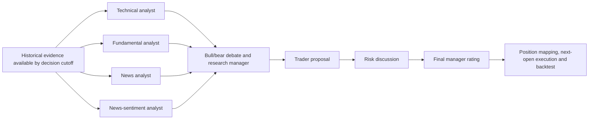

# Evaluating Multi-Agent Collaboration in LLM-Based Trading

**MSBD 5018 Group Project Proposal (Fall 2026)**  
**Topic:** Multi-Agent Collaboration  
**Team:** Zhou Xiaoyang (coordination and analysis), Zhou Runyu (system), Li Ziqi (data and evaluation), Zhao Tianyu (experiments)  
**Date:** October 16, 2026

## 1. Task Introduction

We test whether specialized large language model (LLM) agents improve trading decisions over a single agent receiving the same historical evidence. Adapting TradingAgents (Xiao et al., 2025), we use a shared LLM API, role-specific prompts, and the workflow in Figure 1; no model training is required. The news analyst examines events and business implications; the sentiment analyst assesses the tone of the same news texts, explicitly using news-derived rather than social-media sentiment.

<!-- FRAMEWORK_FIGURE -->

*Figure 1. Proposed information flow; news and sentiment roles share historical news inputs.*

## 2. Why This Task Is Important

Specialized agents may identify complementary evidence and challenge unsupported conclusions, but discussion can also propagate shared errors and increase inference cost. Trading provides measurable decisions for studying these trade-offs. We ask whether staged collaboration improves risk-adjusted performance enough to justify its cost. A same-evidence single-agent control, a debate ablation, and explicit cost reporting support a controlled evaluation without presuming that a more elaborate workflow is better.

## 3. Proposed Methodology

**Data and protocol.** We will evaluate AAPL, GOOGL, and AMZN over a contiguous historical window in 2026, targeting 40-60 trading days. The exact dates will be fixed using news availability and the pilot cost estimate before running strategy evaluations, without selecting periods by profitability. Inputs will combine cached Yahoo prices and corporate actions, SEC financial facts, and timestamped historical news headlines or summaries. We will deduplicate news, verify company relevance, and filter all evidence by the simulated market close. The news source and text granularity will be validated and frozen before experiments; no particular paid provider is required. The first 60% of trading days will be used for development and the remaining 40% reserved for final evaluation.

**Systems and experiments.** All LLM conditions will use the same DeepSeek Flash model, reasoning configuration, eligible evidence bundles, and final decision format. We will pin code and dependencies, log the served model ID and prompts, and exclude cross-date learning memory to keep histories comparable. The main comparison is the four-analyst workflow versus a single-agent decision-maker. Buy and Hold, SMA(20/50), and MACD(12/26/9) provide rule-based baselines. A no-bull/bear-debate ablation on the development segment will examine the contribution of research discussion. Development errors and stage-level cost logs will guide one workflow improvement, such as skipping debate when analysts agree. Its rule and parameters will be frozen before a single final held-out evaluation.

**Evaluation and feasibility.** Final ratings map to long-only positions: Buy/Overweight to invested, Underweight/Sell to cash, and Hold to the previous position. Decisions execute at the next trading session's open, with a fixed 10-bps cost per unit turnover. We will report compounded net return, annualized Sharpe ratio, maximum drawdown, and paired differences by stock, together with LLM calls, tokens, API cost, latency, and failures. A staged pilot of 3-20 four-analyst decisions will determine feasible scale within an $80 total API budget. Core comparisons take priority over optional ablations. Short-window uncertainty, historical data revisions, mutable API models, and possible pretrained knowledge of past events will be discussed. Because inference budgets differ, performance differences will not be attributed solely to collaboration; negative findings will also be reported.

**Plan and deliverables.** October: validate data, pilot costs, and implement controls; early November: run development experiments and freeze one improvement; by November 17: submit main results; by December 9: submit an ACL-format report of at most eight pages and reproducible code, prompts, data references, and experiment manifests. Zhou Runyu leads system implementation, Li Ziqi data and backtesting, Zhao Tianyu experiments and cost accounting, and Zhou Xiaoyang coordination, analysis, and report integration.

**References:** Xiao, Y., Sun, E., Luo, D., and Wang, W. (2025). TradingAgents: Multi-Agents LLM Financial Trading Framework. arXiv:2412.20138. Du, Y., Li, S., Torralba, A., Tenenbaum, J. B., and Mordatch, I. (2023). Improving Factuality and Reasoning in Language Models through Multiagent Debate. arXiv:2305.14325.
