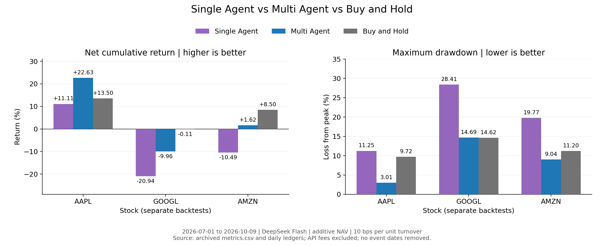
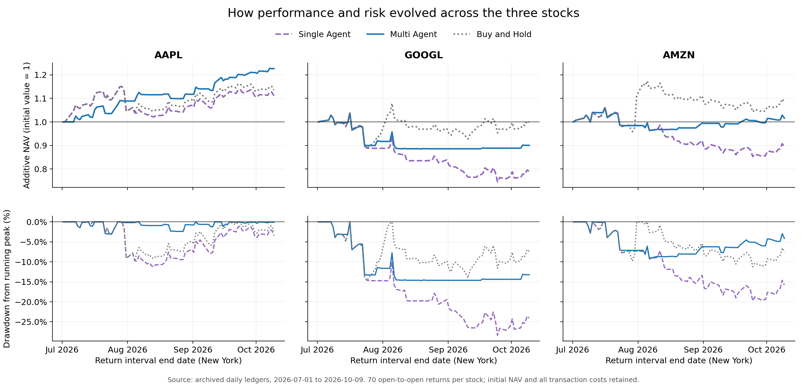

# 单Agent与多Agent实验结果

本窗口内多Agent在三股上的收益和最大回撤均优于单Agent；多Agent仅在AAPL跑赢买入持有。样本有限，不能推广为普遍结论，也不能把差异完全归因于协作机制。



- AAPL：单Agent收益+11.11%、最大回撤11.25%；多Agent收益+22.63%、最大回撤3.01%；买入持有收益+13.50%、最大回撤9.72%。
- GOOGL：单Agent收益-20.94%、最大回撤28.41%；多Agent收益-9.96%、最大回撤14.69%；买入持有收益-0.11%、最大回撤14.62%。
- AMZN：单Agent收益-10.49%、最大回撤19.77%；多Agent收益+1.62%、最大回撤9.04%；买入持有收益+8.50%、最大回撤11.20%。



## 实验口径与限制

- 基于同一 DeepSeek Flash 的三股历史对照，每股72条信号、70个收益区间；含2026-06-30种子日。
- 多Agent为技术、基本面、新闻三分析师，共11个决策角色；单Agent一次性综合原始证据。
- 单Agent读取参考实验中当日已结算的历史记忆：同股最多5条、跨股3条；不是自身独立交易形成的记忆。
- 输入由归档重建，旧版实际工具查询和记忆提示词未逐次保存，不声称输入逐字一致。
- BUY目标持仓1、SELL目标持仓0、HOLD延续；次日开盘执行，10bps换手成本，采用加法净值。
- 215条首次格式成功、1条缺括号离线恢复；原始响应和HOLD动作保留，无额外修复模型调用。
- 本实验没有运行GPT-6.1 Sol；图中不混入后续情绪、辩论或仓位优化实验。

## 新增模型调用成本

单Agent216次已记录逻辑调用，输入14,677,789、输出1,201,647 token（输出已含推理）。返回usage计价19.24元；2026-11-09账户累计减少19.47元，与usage计价约0.23元差额未核销。这不是当前余额；不包含既有多Agent和共享记忆的成本，API费用不扣进图中交易收益。

## 代码与复现

周晓杨负责单Agent方案、预算与整合，Codex辅助实现、执行及结果整理。

仅从归档生成本页和图表，无需密钥，也不调用模型：

```bash
python -m experiments.plot_single_agent_comparison
```

从已有信号重新运行完整Notebook回测（无模型调用），再画图：

```bash
python -m experiments.compare_single_agent --tickers AAPL,GOOGL,AMZN
python -m experiments.plot_single_agent_comparison
```

- [单Agent代码](../../agents/single_agent.py)
- [实验协议](../../experiments/single_agent_protocol.json)
- [绘图与校验代码](../../experiments/plot_single_agent_comparison.py)
- [统一Notebook](../../analysis.ipynb)
- [216条单Agent信号](../../data/decisions/deepseek-flash-single-shared-memory-2026jul-oct-v1.csv)
- [全部五策略原始指标](../single_vs_multi_AAPL_GOOGL_AMZN/metrics.csv)
- [三方法汇总CSV](comparison_metrics.csv)
- [离线HTML报告](index.html)
- [来源哈希与校验](provenance.json)
